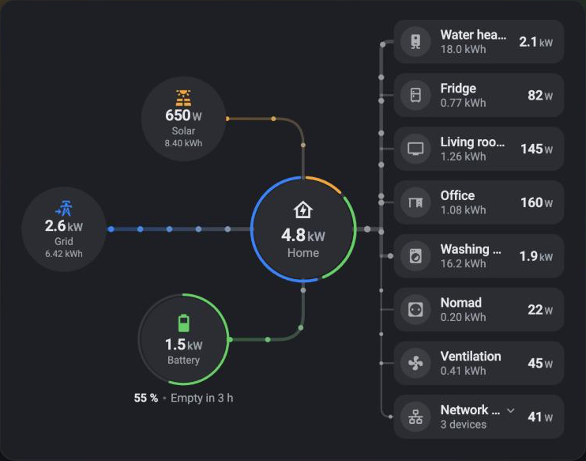
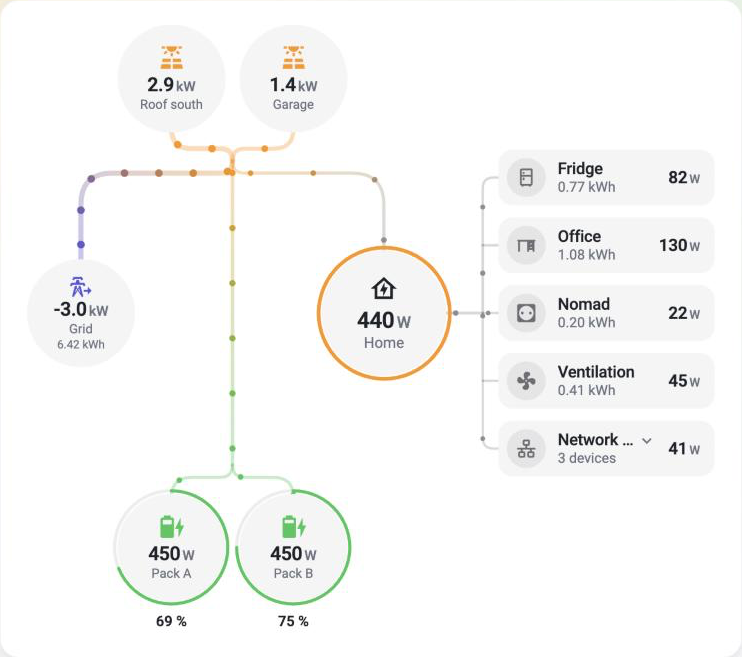
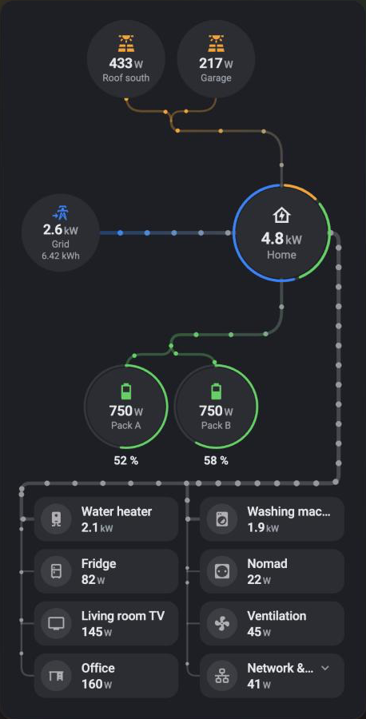

# Live Energy Card

A Home Assistant Lovelace card that shows your home's energy flows **live**: solar, grid, battery,
home and individual devices. The design follows iOS app conventions: neutral surfaces, with system
colors reserved for icons and flows. Each flow's animation follows its power.

```
            Solar
   Grid              Home ──┬── Devices
           Battery          └── …
```

**[Try the live demo](https://pyozer.github.io/ha-live-energy-card/)**: the card with simulated data,
sliders for every source and device, scenarios, and a YAML editor. No Home Assistant needed.

<p align="center">
  
  
</p>
<p align="center">
  
</p>

## Features

- **Animated flows** whose speed, thickness, particle density and glow depend on the power. Each
  of these four effects can be toggled separately (globally or per node).
- **Several inverters or batteries**: added up in one bubble, or, with `separate: true`, one bubble
  each with its own power, name, icon and color. Several entities on the grid, the home or a device
  are added up too.
- **Device groups** that expand with a tap.
- **Every source is optional**: without solar, battery or grid, the layout rearranges itself with
  no gaps.
- **Hide when zero**, configurable globally or per node, with a fade.
- **Devices in a column or a grid**: with many devices, the card switches to a grid fed by a bus.
  Each bus segment carries the sum of the devices downstream. On narrow screens, devices move
  below the diagram.
- **Line styles**: rounded corners, square corners, curves or direct lines, applied to every line
  of the card.
- **Live cost, solar savings and grid CO₂**, calculated or read from your own entities.
- **Home ring**: share of solar, battery and grid in the consumption.
- **Battery ring**: state of charge.
- Automatic unit conversion (W, kW, MW), animated counters, tabular figures.
- `unavailable` / `unknown` entities are reported cleanly: never `NaN`.
- `tap_action`, `hold_action`, `double_tap_action` on every node and on the cost, savings and CO₂ indicators (more-info by default).
- Automatic light and dark themes, `prefers-reduced-motion` support, animation paused off-screen,
  **eco mode** for low-power devices.
- **Import from the Energy dashboard**: solar, grid, battery and devices in one click.
- Full visual editor whose entity pickers only offer matching entities (power sensors for flows,
  percentages for the charge level) and that flags entities to check: not found (renamed or removed)
  or not matching their field (an energy counter in a power field…). English and French translations
  (following the Home Assistant user's language, or set per card).

## Installation

### HACS (recommended)

With [HACS](https://hacs.xyz), the card is installed in a few clicks, and updates are offered as new
versions come out.

1. Click the button, which opens this repository in HACS on your Home Assistant instance (it asks
   for its address the first time):

   [](https://my.home-assistant.io/redirect/hacs_repository/?owner=Pyozer&repository=ha-live-energy-card&category=plugin)

   Or add it by hand: **HACS → ⋮ → Custom repositories**, with
   `https://github.com/Pyozer/ha-live-energy-card` and the *Dashboard* type.
2. Click **Download** on **Live Energy Card**. HACS fetches `live-energy-card.js` from the latest
   GitHub release and registers it as a dashboard resource.
3. Reload the page without cache (Ctrl/Cmd + Shift + R).
4. Add the card: **Edit dashboard → Add card → Live Energy Card**.

### Manual

1. Download `live-energy-card.js` from the
   [latest release](https://github.com/Pyozer/ha-live-energy-card/releases/latest) and copy it to
   `/config/www/live-energy-card.js` (via the Samba add-on, File editor or SSH).
2. **Settings → Dashboards → ⋮ → Resources → Add resource**:
   - URL: `/local/live-energy-card.js?v=1` (any value: change it after each update, see below)
   - Type: *JavaScript module*
3. Reload the page without cache (Ctrl/Cmd + Shift + R).
4. Add the card: **Edit dashboard → Add card → Live Energy Card**.

For each new version, copy the file again and increment `?v=` to bypass the browser and mobile app
caches.

## Configuration

### Import from the Energy dashboard

If the Home Assistant **Energy dashboard** is set up with power sensors (the "power" fields of
solar, grid, battery and individual devices), the card configures itself:

- when the card is added (**Add card → Live Energy Card**), the suggested configuration is
  imported from the Energy dashboard;
- in the visual editor, **Import from the Energy dashboard** adds the missing sources and devices
  to an existing card. The imported grid replaces the configured entities but keeps its name, icon
  and color; inverters and batteries are added as units next to the ones already in the card;
  devices already in the card are kept, and get their energy counter if they lacked it.

The dashboard's energy counters are imported too (`energy_entity`), so solar, grid import and each
device show **today's energy** under their power. Each inverter and each battery of the dashboard
becomes a unit (see [Several inverters and batteries](#several-inverters-and-batteries)).

Sources and devices without a power sensor are skipped (the dashboard's energy statistics in kWh
cannot show live flows). A device "included in" another listed device becomes a member of
that device's group. Without an Energy dashboard, the card guesses power sensors from
their names.

### Full example

```yaml
type: custom:live-energy-card
max_power: 4000
solar:
  secondary_entity: sensor.panneaux_solaires_energie_du_jour
  units:
    - entity: sensor.shelly_solaire_puissance
grid:
  entity: sensor.shelly_pro_3em_energy_meter_1_puissance # positive = import
battery:
  units:
    - entity: sensor.batterie_puissance # positive = discharge
      soc_entity: sensor.batterie_niveau
devices:
  - entity: sensor.shelly_pro_3em_energy_meter_3_puissance
    name: Water heater
    icon: mdi:water-boiler
  - entity: sensor.prise_frigo_power
    name: Fridge
    icon: mdi:fridge-outline
  - entity: sensor.prise_lave_linge_power
    name: Washing machine
    icon: mdi:washing-machine
```

### Without a battery

```yaml
type: custom:live-energy-card
solar:
  units:
    - entity: sensor.shelly_solaire_puissance
grid:
  entity: sensor.shelly_pro_3em_energy_meter_1_puissance
devices:
  - entity: sensor.prise_frigo_power
```

### Without solar, with separate grid entities

```yaml
type: custom:live-energy-card
grid:
  import_entity: sensor.linky_import_power
  export_entity: sensor.linky_export_power
home:
  entity: sensor.home_consumption_power
```

### Device groups

A group is shown as a single device with the total power of its members. Tap it to expand it: the
group stays as a header and its members appear after it, each with its own flow. Tap again to
collapse it.

In the visual editor, **drag a device by its handle** (mouse, touch or pen) to reorder the list,
move it into a group (drop it on the group's header), take it out of a group or move it to another
one. A group can be reordered among the top-level devices, but not placed inside another group. With
the keyboard, focus the handle and use the up and down arrows.

```yaml
type: custom:live-energy-card
grid:
  entity: sensor.grid_power
devices:
  - entity: sensor.fridge_power
  - name: Kitchen
    icon: mdi:stove
    # Optional: a meter for the whole circuit. Without it, the members are added up.
    entity: sensor.kitchen_circuit_power
    expanded: false
    devices:
      - entity: sensor.oven_power
      - entity: sensor.hob_power
```

### Several inverters and batteries

The solar and battery sources are made of **units**: an inverter, a string of panels, a battery
pack. Each unit reads its own entities. A single bubble adds the units up, which is the default.

```yaml
type: custom:live-energy-card
solar:
  name: Solar # the single bubble: its name, icon and color are set here
  units:
    - entity: sensor.inverter_roof_power
      energy_entity: sensor.inverter_roof_energy
    - entity: sensor.inverter_garage_power
      energy_entity: sensor.inverter_garage_energy
grid:
  entity: # several entities (phases) are added up too
    - sensor.grid_l1_power
    - sensor.grid_l2_power
    - sensor.grid_l3_power
battery:
  units:
    - entity: sensor.battery_1_power
      soc_entity: sensor.battery_1_level
      capacity: 5
    - entity: sensor.battery_2_power
      soc_entity: sensor.battery_2_level
      capacity: 10
```

With `separate: true`, each unit gets its own bubble instead, which shows which inverter produces
and which battery charges. The grid and the home are never split.

```yaml
solar:
  separate: true
  units:
    - entity: sensor.inverter_roof_power
      name: Roof
      icon: mdi:solar-panel-large
    - entity: sensor.inverter_garage_power
      name: Garage
      color: teal
```

What a unit reads is always set on the unit; its *bubble* (what it looks like and does) is set on the
node for a single bubble, and on each unit for a bubble per unit. Switching from one display to the
other loses nothing.

| On the unit | On the node (single bubble), or on each unit (`separate`) |
| --- | --- |
| `entity`, `invert`, `energy_entity` | `name`, `icon`, `color`, `hide_when_zero`, `secondary_entity`, `animation`, `tap_action`, `hold_action`, `double_tap_action` |
| battery: `charge_entity`, `discharge_entity`, `soc_entity`, `capacity`, `min_soc` | battery: `charge_color` |

- A unit's `entity` is a single entity: one sensor per unit. A battery unit has a signed `entity`
  (positive = discharge) or a `charge_entity` and a `discharge_entity`.
- **A single bubble** adds the units up, and is unavailable as soon as one of them is, so a partial
  total is never shown. Its charge level is the average of the units', weighted by their
  `capacity` when each has one, and its time to full or to the reserve is estimated on the sum of the
  capacities (with the reserves weighted the same way) when every unit has a charge level and a
  capacity. As soon as one of them has no level or no capacity, there is no estimate.
- **A bubble per unit**: an unavailable unit counts as 0 and is flagged on its own, the others still
  count. A unit's bubble shows its icon and value, plus its name and daily energy when there is
  room. Units that do not fit on one row wrap on a second one, and shrink with the width of the card.
  A battery unit can charge while another one discharges, the source keeping the net balance.
- The flows to the home, the grid and the other source carry the total, whatever the display, so
  the energy balance, the ratios, the cost and the carbon do not depend on it. With a bubble per
  unit, they start at the point where the units meet.
- The energy of the day of the source is the sum of its units' `energy_entity`, when each has one:
  that is what the daily solar savings need.
- The visual editor lists the units under the form of the source, where they can be added, removed
  and reordered (drag the handle, or use the arrow keys on it).

> **Breaking change**: `entity`, `energy_entity`, `invert` (and, for the battery, `soc_entity`,
> `charge_entity`, `discharge_entity`, `capacity` and `min_soc`) are no longer options of `solar` and
> `battery`: move them to a unit, `solar: { units: [{ entity: … }] }`. The card says so in its error
> message.

### Six devices in a grid, dimmed idle flows

```yaml
type: custom:live-energy-card
inactive_flows: dim
devices_layout: grid
devices_columns: 2
sort_devices: true
show_untracked: true
grid:
  entity: sensor.shelly_pro_3em_energy_meter_1_puissance
devices:
  - entity: sensor.prise_chaudiere_power
    name: Boiler
  - entity: sensor.prise_frigo_power
    name: Fridge
  - entity: sensor.prise_salon_power
    name: Living room TV
  - entity: sensor.prise_bureau_power
    name: Office
  - entity: sensor.vmc_power
    name: Ventilation
  - entity: sensor.box_internet_puissance
    name: Internet box
```

### General options

| Option | Default | Description |
| --- | --- | --- |
| `title` | — | Title shown at the top of the card. |
| `language` | `auto` | Language of the default labels: `auto` (language of the logged-in Home Assistant user), `en` or `fr`. |
| `min_power` / `max_power` | `0` / `5000` | Range (W) used to compute flow intensity. |
| `power_curve` | `sqrt` | `linear`, `sqrt` or `log`. `sqrt` and `log` make low power easier to read. |
| `threshold_w` | `5` | Below this threshold, a value is treated as zero. |
| `hide_when_zero` | `true` | Hides nodes at zero (solar, battery, devices). Grid and home stay visible unless set explicitly. |
| `line_style` | `rounded` | Shape of every flow line: `rounded` (right angles with rounded corners), `square` (sharp right angles), `curved` (soft curves) or `straight` (direct lines). |
| `inactive_flows` | `hide` | `hide`: zero flows are invisible. `dim`: dimmed grey path. |
| `animation` | see below | Intensity effects: `speed`, `thickness`, `density` (on), `glow` (off: soft light around particles, stronger as power increases). |
| `transparent` | `false` | Removes the card background, border and shadow, so the diagram sits directly on the dashboard (or inside a stack / grid card). Nodes keep their own fill and stay readable. |
| `eco_mode` | `false` | Lighter animation for wall tablets and low-power devices: 30 frames per second instead of the display rate, and no glow (its blur is the most expensive effect). Roughly halves the rendering work. |
| `devices_layout` | `auto` | `auto`, `column` or `grid`. |
| `devices_columns` | auto | Number of columns in grid mode. |
| `sort_devices` | `false` | Sorts devices by power (with hysteresis so the list does not keep moving). |
| `show_untracked` | `false` | Adds an "Other" node: home consumption not covered by the devices. |
| `show_ratios` | `false` | Shows self-consumption (share of solar used on site) and self-sufficiency (share of consumption covered without the grid). Shown only while the solar bubble is displayed: they disappear with it (no solar source, or idle solar with `hide_when_zero`). |
| `cost` | — | Prices for the live cost and solar savings (see [Cost and carbon](#cost-and-carbon)). |
| `carbon` | — | `intensity_entity`: grid carbon intensity for the live CO₂ (see [Cost and carbon](#cost-and-carbon)). |
| `kilo_threshold` | `1000` | Switch from W to kW. |
| `decimals` / `kilo_decimals` | `0` / `1` | Decimals in W and in kW. |

### Node options

Available for `grid`, `home` and each item of `devices` (and for each unit of `solar` and `battery`, see
[Several inverters and batteries](#several-inverters-and-batteries)):

| Option | Description |
| --- | --- |
| `entity` | Power entity (W, kW…), or a list of entities whose values are added up (grid phases, or a device made of several plugs). For `grid`: positive = import. |
| `name`, `icon` | Label and icon. |
| `color` | HA color name (`amber`, `blue`…) or CSS color. |
| `invert` | Inverts the entity's sign. |
| `hide_when_zero` | Overrides the global option. |
| `energy_entity` | **Energy of the day.** Cumulative energy counter(s) in kWh, as used by the Energy dashboard (a list is added up). The card shows the change since midnight, read from the Home Assistant statistics (refreshed every 5 minutes), always in kWh. The counter does not need to reset daily. Shows `—` when a counter has no statistics. |
| `secondary_entity` | **Custom line.** Any entity (a daily `utility_meter`, a cost, a temperature…), shown as is with its own unit, live. It *replaces* the energy of the day: when both are set, `energy_entity` is ignored (the editor warns about it). |
| `animation` | Overrides the intensity effects for this node's flows. |
| `tap_action`, `hold_action`, `double_tap_action` | Standard Home Assistant actions. |

Specific options:

- `grid`: `import_entity` / `export_entity` (alternative to a signed entity; both report positive
  values), `export_energy_entity` (energy counter(s) in kWh of the energy sent to the grid: shown on
  the bubble next to the energy bought, `↓6.88 ↑0.99 kWh`, and used by the daily cost),
  `export_color`,
  `max_import` (import limit in W, e.g. the subscribed power: above it, the grid node turns red and
  shows *Over limit*). The grid node shows a signed value: positive when importing, **negative when
  exporting** (a signed entity keeps its sign, an export entity is shown as negative).
- `solar` and `battery`: `separate` and `units`, see
  [Several inverters and batteries](#several-inverters-and-batteries). On a battery unit:
  `charge_entity` / `discharge_entity` (alternative to a signed `entity`), `soc_entity` (charge level
  in %), `charge_color`, `capacity` (usable capacity in kWh) and `min_soc` (reserve in %, default 0):
  with a charge level and a capacity, the caption shows the time to full or down to the reserve at
  the current power (*Full in 2 h 05*), up to 48 h.
- `home`: `entity` is optional. Without it, consumption is computed from the sources.
- `devices` groups: `devices` (members, same options as a device), `expanded` (initially
  expanded), `entity` optional. A group's default tap action expands or collapses it.
- `devices`: `exclude_from_untracked: true` for a device that is not part of the home consumption
  (separate circuit, or a sub-meter of another device already listed). Its power is not
  subtracted when computing "Other".

### Cost and carbon

Live indicators shown under the diagram. `cost.period` picks how cost and savings are expressed:

- `hour` (default): a **rate per hour** (€/h) from the current flows.
  - **Cost**: grid import × import price − grid export × export price. When the export earns more
    than the import costs, it is shown as **Export earnings**.
  - **Solar savings**: solar consumed on site (home and battery charge) × import price.
- `day`: a **total for the day** (€), from today's energy counters (kWh), like the Energy dashboard.
  - **Cost today** = grid import × import price − grid export × export price.
  - **Solar savings today** = (solar production − energy sent to the grid) × import price.
  - Needs `energy_entity` on every solar unit and on `grid` (the import), plus `grid.export_energy_entity`
    (the energy sent to the grid); the Energy dashboard import fills the three in. While a counter is missing, the indicator is hidden
    rather than wrong.
  - Today's energy is priced at the **current** price: with a tariff that changes during the day
    (peak / off-peak, dynamic prices), the total is an approximation. A *cost entity* (below) gives
    an exact total.
- **Grid CO₂**: grid import × carbon intensity of the grid (for example from the
  [Electricity Maps](https://www.home-assistant.io/integrations/co2signal/) integration), per hour.

```yaml
cost:
  period: day # hour (default): €/h from the current power; day: total of the day
  price_entity: sensor.electricity_price # or a fixed value: price: 0.2516
  export_price: 0.13 # or export_price_entity
  currency: EUR # optional: price entity unit (EUR/kWh), then the Home Assistant currency
carbon:
  intensity_entity: sensor.electricity_maps_co2_intensity # gCO2eq/kWh
```

Each price (import, export) comes from **one** source:

| Source | Import | Export | Value |
| --- | --- | --- | --- |
| Fixed value | `price` | `export_price` | A price per kWh. |
| Price entity | `price_entity` | `export_price_entity` | A price per kWh, read live (dynamic tariff). |
| Cost entity | `cost_entity` | `earnings_entity` | An amount **already computed**, shown as is. |

The **solar savings** have their own source, independent of the import cost: calculated by default
(solar consumed on site × import price), or a **savings entity** (`savings_entity`) already computed
elsewhere, which replaces the calculation:

```yaml
cost:
  period: day
  cost_entity: sensor.electricity_cost_today # what the grid cost
  savings_entity: sensor.solar_savings_today # what the solar avoided paying
```

It follows `cost.period` like the cost entity: a rate (`€/h`) per hour; a total in `€` per day,
cumulative (today's change is taken from the statistics) or reset daily. It needs no price, so it
works together with a cost entity.

A *cost entity* is for people who already have the cost computed (dynamic tariffs, tariff
calculators…). Its unit is a currency: `€/h` with `period: hour`; a cost in `€` with `period: day`,
either cumulative (like the Energy dashboard's cost sensors: today's change is taken from the
statistics) or reset every day (without statistics, the state is used as is). No price is involved,
so the calculated **Solar savings** are not shown with a cost entity for the import (they need a
price), unless you give a savings entity (below); a cost entity can be mixed with a price on the other
side.

If several sources are set in YAML, the strongest wins and the others are ignored (the editor flags
it): cost entity, then price entity, then fixed value. In the visual editor, pick the source
(*None*, *Fixed value*, *Price entity* or *Cost entity*) and only the matching field is shown;
switching source drops the other fields.

**Tap an indicator to see its details**: when it comes from an entity (a cost, earnings or savings
entity, or the carbon intensity entity), tapping it opens that entity's more-info dialog (history,
graph), like a bubble. An indicator that is calculated from prices and flows has no entity behind it
and is not tappable. When the earnings are shown instead of the cost (a negative cost), the earnings
entity is the one that opens.

Like on a bubble, each indicator can have its own `tap_action`, `hold_action` and `double_tap_action`
(standard Home Assistant actions), which replace the default more-info. They also work on a calculated
indicator, which makes it tappable:

| Indicator | Option | Default |
| --- | --- | --- |
| Cost / export earnings | `cost.cost_actions` | more-info of `cost_entity` (or `earnings_entity` for the earnings) |
| Solar savings | `cost.savings_actions` | more-info of `savings_entity` |
| Grid CO₂ | `carbon.actions` | more-info of `intensity_entity` |

```yaml
cost:
  period: day
  price_entity: sensor.electricity_price
  cost_actions:
    tap_action:
      action: navigate
      navigation_path: /energy
carbon:
  intensity_entity: sensor.electricity_maps_co2_intensity
  actions:
    tap_action:
      action: none # not tappable
```

Prices are per kWh; price entities in €/MWh or €/Wh are converted. Without an export price (*None*), the
exported energy is not counted. The Energy dashboard import fills in the prices when the grid has
a single tariff.

### Language

Default labels (Solar, Grid, Battery, Home, states, ratios) follow the language of the logged-in
Home Assistant user. Set `language: en` or `language: fr` to force a language for a card. A node's
`name` option always takes precedence over the translated label. Numbers keep the Home Assistant
number format.

### Colors

Default colors are the iOS system colors, with their dark variants. Themes can override them with
the `--lec-solar`, `--lec-grid`, `--lec-export`, `--lec-battery`, `--lec-home`, `--lec-device` and `--lec-alert`
variables.

## Flow computation

Signed powers are first split into positive components (import / export, charge / discharge). If
both directions are measured at the same time, only the net value is kept. Home consumption is
either measured (`home.entity`) or computed:

```
home = solar + import + discharge − export − charge
```

Allocation then follows fixed priorities:

1. **Solar** → home, then battery (if charging), then grid (surplus).
2. **Battery** (if discharging) → home, then grid.
3. **Grid** → remaining home demand, then battery charge.

The solar and battery totals are the sum of their units. With a bubble per unit, the units' own flows
join at the point from which the flows above start.

In grid mode, each bus segment carries the sum of the devices downstream.
"Other" equals `home − Σ devices` (devices with `exclude_from_untracked` left out), never negative.

## Development

```bash
npm install
npm run dev        # demo page at http://localhost:5173/demo/
npm test           # unit tests (Vitest)
npm run coverage   # tests with coverage thresholds
npm run lint
npm run build      # produces dist/live-energy-card.js
npm run build:demo # produces the demo page as a static site in dist-demo/
npm run check      # lint, formatting, tests with coverage and build (before every commit)
```

Contribution and commit rules are in [CONTRIBUTING.md](CONTRIBUTING.md). The project's technical
context (architecture, conventions, testing) is in [AGENTS.md](AGENTS.md).

The demo page works **without Home Assistant**. It simulates `hass` and provides:

- scenarios (night, surplus, solar water heater, peak, off-peak battery charge, battery → grid);
- a slider per source and per device, the grid being computed automatically from the balance;
- cost and CO₂ indicators;
- unavailable entity simulation and a random "live" simulation;
- light/dark modes, FR/EN and card width;
- a YAML configuration editor and a simulated Energy dashboard import.

Code changes are hot-reloaded.

The visual editor (`ha-form`) only works inside Home Assistant.

The online demo is rebuilt and published on GitHub Pages at every push to `main`.

## License

[MIT](LICENSE)
